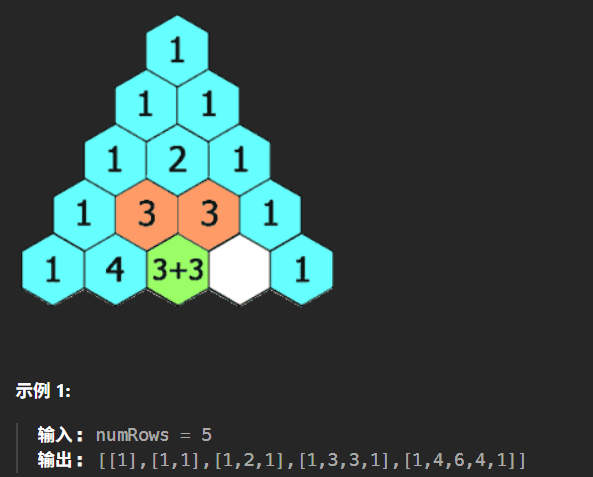

# 记录
---
- 题目:
  给定一个非负整数 numRows，生成「杨辉三角」的前 numRows 行。
  在「杨辉三角」中，每个数是它左上方和右上方的数的和。
- 示例
  
---
- 思路：
  先建一个numRows个元素的二维vector，然后逐行计算存储每一行元素。
- 代码：
  ```cpp
  class Solution {
  public:
      vector<vector<int>> generate(int numRows) {
          vector<vector<int>> res(numRows);
          for(int i = 0;i<numRows;i++){
              if(i == 0){
                  res[i].emplace_back(1);
              }
              else{
                  res[i].emplace_back(1);
                  for(int j = 0;j<res[i-1].size()-1;j++){
                      res[i].emplace_back(res[i-1][j]+res[i-1][j+1]);
                  }
                  res[i].emplace_back(1);
              }

          }
          return res;
      }
  };
  ```
- 结果
  时间100,空间24