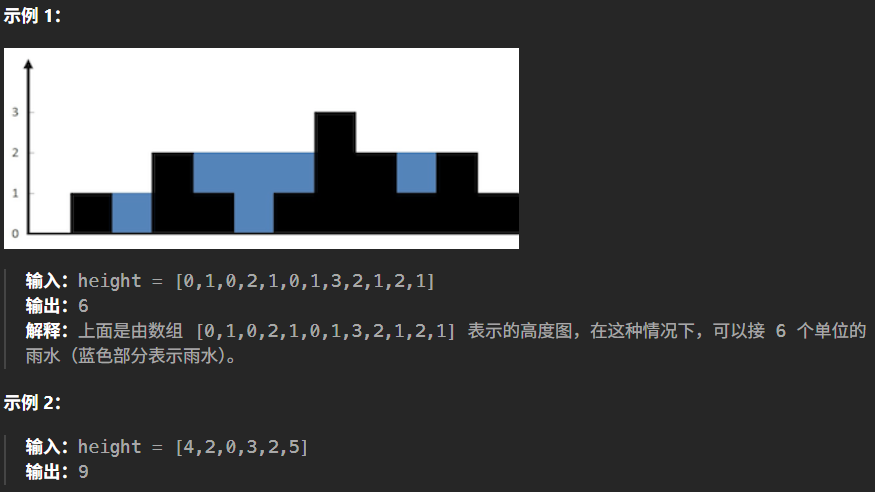
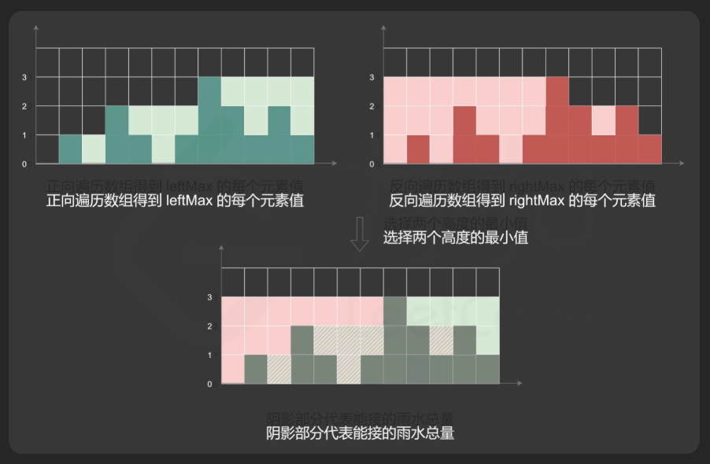

# 记录
---
- 题目：
  给定 n 个非负整数表示每个宽度为 1 的柱子的高度图，计算按此排列的柱子，下雨之后能接多少雨水
- 示例：
  
---
- 思路
  按行求容积，记录每行的块数与最左最右的位置，就可以算出当前行接了多少雨水
- 代码
  ```java
  class Solution {
    public int trap(int[] height) {
        ArrayList<ArrayList<Integer>> li = new ArrayList<>();
        int res = 0;
        for(int i = 0;i<height.length;i++){
            for(int j = 0;j<height[i];j++){
                if(li.size()==j){
                    li.add(new ArrayList<>(3));
                    li.get(j).add(Integer.MAX_VALUE);
                    li.get(j).add(Integer.MIN_VALUE);
                    li.get(j).add(0);
                }
                li.get(j).set(0,Math.min(li.get(j).get(0),i));
                li.get(j).set(1,Math.max(li.get(j).get(1),i));
                li.get(j).set(2,li.get(j).get(2)+1);
            }
        } 
        for(int i = 0;i<li.size();i++){
            res+=(li.get(i).get(1)-li.get(i).get(0) - 1 - li.get(i).get(2) + 2);
        }
        return res;
    }
  }
  ```
- 结果
  超时了,确实,如果容器一直很大,那么会循环好多次
---
- 思路2
  滑动窗口求容积,双指针都从左往右移动,左指针不动,当右指针遇到比左指针高的,结算一次,左指针直接传送到右指针处.需要记录这个过程中右指针遇到的高度和
  做的过程中发现这个做法是有缺陷的,如果左指针指向的柱子就是最高的,那么结算不会发生
  于是需要先找到最高的柱子,然后以它为准,分开左右两边去计算
  这样就能确保两边都肯定会发生结算
  如果所有柱子一样高,那么最高的柱子就是在最后面的那个,不影响算法的可用性
- 代码:
  ```java
  class Solution {
    public int trap(int[] height) {
        int left = 0;
        int right = 1;
        int temSum = 0;
        int res = 0;
        int curMax = 0;
        int curMaxI = 0;
        //先找出最高的柱子
        for(int i = 0;i<height.length;i++){
            if(height[i]>curMax){
                curMax = height[i];
                curMaxI = i;
            }
        }
        //从左到最高柱子
        while(right<=curMaxI){
            while(height[left]>height[right]){
                temSum+=height[right];    
                right++;
            }
            res += height[left]*(right-left-1)-temSum;
            temSum = 0;
            left = right;
            right++;
        }
        left = height.length-2;
        right = left+1;
        //从右到最高柱子
        while(curMaxI<=left){
            while(height[left]<height[right]){
                temSum+=height[left];    
                left--;
            }
            res += height[right]*(right-left-1)-temSum;
            temSum = 0;
            right = left;
            left--;
        }
        return res;
    }
  }
  ```
- 结果
  时间82,空间76
---
**他人的思路**
- 思路:
  将实例图中的蓝色也看成实心的，算出每一层的面积，加起来，然后减去height的总和，剩下的就是水量。
  定义一个双指针，以及层数h=1，双指针在两头往中间移动，只要指针大于等于h，就停下来
  目的：当两边指针都停下来的时候，计算第一层的面积（直接左指针减右指针+1），然后h++计算第二层的面积，以此类推计算每一层的面积，然后用这个面积减去height的和，剩下的就是水量了
- 解析:
  计算像蛋糕塔一样的总面积,减去中间的柱子,就是水了
  双指针向内移动,每个柱子都只看一次
  但是层数高的话,也要计算个层数次
- 代码:
  ```cpp
  class Solution {
  public:
      int trap(vector<int>& height) {
          int n=height.size();
          int maxHeight = INT_MIN;
          int totalH=0;
          for(int i=0;i<n;i++)
          {
              totalH+=height[i];
              maxHeight=max(maxHeight,height[i]);
          }

          int i=0,j=n-1;
          int sum=0;
          for(int h=1;h<=maxHeight;h++)
          {
              while(height[i]<h)i++;
              while(height[j]<h)j--;
              sum+=(j-i+1);        
          }
          return sum-totalH;
      }
  };
  ```
- 结果:
  时间27,空间80
---
**题解的做法(动态规划)**
- 思路:
  对于每一个位置,其所能接到雨水,这个雨水的高度由从当前位置出发,左右两边最高的两根柱子中的更低的柱子决定.这个位置实际接受到的雨水还需减去当前位置柱子高度
  实际上,这个高度是可以传递的,可以记录从左往右的最高高度,和从右往左的最高高度
  当前位置的雨水高度,就是其左边的最高高度和右边的最高高度中更小的那个
  如图所示：
- 代码：
  ```java
  class Solution {
    public int trap(int[] height) {
        int n = height.length;
        if (n == 0) {
            return 0;
        }

        int[] leftMax = new int[n];
        leftMax[0] = height[0];
        for (int i = 1; i < n; ++i) {
            leftMax[i] = Math.max(leftMax[i - 1], height[i]);
        }

        int[] rightMax = new int[n];
        rightMax[n - 1] = height[n - 1];
        for (int i = n - 2; i >= 0; --i) {
            rightMax[i] = Math.max(rightMax[i + 1], height[i]);
        }

        int ans = 0;
        for (int i = 0; i < n; ++i) {
            ans += Math.min(leftMax[i], rightMax[i]) - height[i];
        }
        return ans;
    }
  }
  ```
- 复杂度分析
  时空间复杂度都是O(n)
---
**题解的思路(单调栈)**
- 思路
  维护一个单调递减栈,栈里存下标,而不存高度
  从左往右存取
  如果当前高度大于栈顶指向高度且栈里元素大于等于两个,则说明栈顶这里可以装雨水
  其高度为栈下面一个指向的高度和当前遍历到的高度的更小的那个
  雨水容量为雨水高度-栈顶指向的高度
  把栈顶弹出,如果当前栈顶仍满足条件,则继续执行雨水容量计算
  否则继续遍历,压栈
- 代码:
  ```java
  class Solution {
    public int trap(int[] height) {
        int ans = 0;
        Deque<Integer> stack = new LinkedList<Integer>();
        int n = height.length;
        for (int i = 0; i < n; ++i) {
            while (!stack.isEmpty() && height[i] > height[stack.peek()]) {
                int top = stack.pop();
                if (stack.isEmpty()) {
                    break;
                }
                int left = stack.peek();
                int currWidth = i - left - 1;
                int currHeight = Math.min(height[left], height[i]) - height[top];
                ans += currWidth * currHeight;
            }
            stack.push(i);
        }
        return ans;
    }
  }
  ```
- 复杂度分析
  时空间都是O(n)
---
**题解的做法(双指针)**
- 思路
  基于动态规划
  注意到下标 i 处能接的雨水量由 leftMax[i] 和 rightMax[i] 中的最小值决定。由于数组 leftMax 是从左往右计算，数组 rightMax 是从右往左计算，因此可以使用双指针和两个变量代替两个数组。
  维护两个指针 left 和 right，以及两个变量 leftMax 和 rightMax，初始时 left=0,right=n−1,leftMax=0,rightMax=0。指针 left 只会向右移动，指针 right 只会向左移动，在移动指针的过程中维护两个变量 leftMax 和 rightMax 的值。
  ```  
  当两个指针没有相遇时，进行如下操作：
  使用 height[left] 和 height[right] 的值更新 leftMax 和 rightMax 的值；
  如果 height[left]<height[right]，则必有 leftMax<rightMax，下标 left 处能接的雨水量等于 leftMax−height[left]，将下标 left 处能接的雨水量加到能接的雨水总量，然后将 left 加 1（即向右移动一位）；
  如果 height[left]≥height[right]，则必有 leftMax≥rightMax，下标 right 处能接的雨水量等于 rightMax−height[right]，将下标 right 处能接的雨水量加到能接的雨水总量，然后将 right 减 1（即向左移动一位）。
  当两个指针相遇时，即可得到能接的雨水总量。
  ```
- 代码:
  ```java
  class Solution {
    public int trap(int[] height) {
        int ans = 0;
        int left = 0, right = height.length - 1;
        int leftMax = 0, rightMax = 0;
        while (left < right) {
            leftMax = Math.max(leftMax, height[left]);
            rightMax = Math.max(rightMax, height[right]);
            if (height[left] < height[right]) {
                ans += leftMax - height[left];
                ++left;
            } else {
                ans += rightMax - height[right];
                --right;
            }
        }
        return ans;
    }
  }
  ```
  

