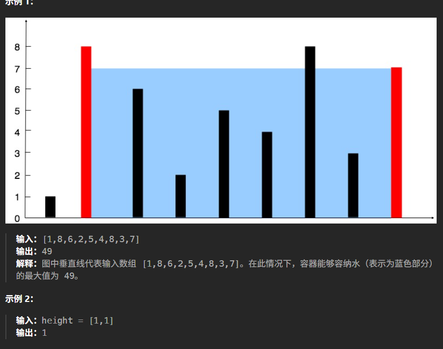

# 记录
---
- 题目:
  给定一个长度为 n 的整数数组 height 。有 n 条垂线，第 i 条线的两个端点是 (i, 0) 和 (i, height[i]) 。
  找出其中的两条线，使得它们与 x 轴共同构成的容器可以容纳最多的水。
  返回容器可以储存的最大水量。
  说明：你不能倾斜容器。
- 示例:
  
---
- 思路：
  之前做过，所以还有点印象
  方法是双指针，一个指向最左边，一个指向最右边，然后不断收缩
  只移动更矮的一方，因为容器高度取决于更矮的一方
  收缩时，也只有使高度提升，才可能找到更大容器
  移动更高的一方，容器大小只会越来越小
  移动更矮的一方，直到找到一个更高的，才换另一个指针移动
  这种方法不是找局部最优
  本质上是收缩,找第一个容器高度变大的,可能比原来容器容积大,也可能更小,新的容器要在那个范围里继续找
  ```cpp
  class Solution {
  public:
      int maxArea(vector<int>& height) {
          int left = 0;
          int right = height.size() - 1;
          int maxWater = 0;
          int maxHight;//容器最大高度
          while(left<right){
              if(height[left]>=height[right]){
                  if(maxHight < height[right]){
                      maxWater = max(maxWater,height[right]*(right-left));
                      maxHight = height[right];
                  }
                  right--;
              }
              else{
                  if(maxHight < height[left]){
                      maxWater = max(maxWater,height[left]*(right-left));
                      maxHight = height[left];
                  }
                  left++;
              }
          }
          return maxWater;
      }
  };
  ```
- 结果:
  时间100,空间85