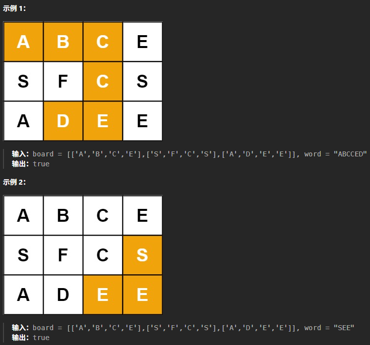

# 记录
- 题目:
  给定一个 m x n 二维字符网格 board 和一个字符串单词 word 。如果 word 存在于网格中，返回 true ；否则，返回 false 。
  单词必须按照字母顺序，通过相邻的单元格内的字母构成，其中“相邻”单元格是那些水平相邻或垂直相邻的单元格。同一个单元格内的字母不允许被重复使用。
- 示例:
  
- 思路:
  依旧递归,依旧回溯.
  遍历可行解:
  如果当前位置是需要的字符,则记录,递归
  舍去无效解:
  i,j位置无效舍去,搜集到的单词长度与目标一致舍去.且此时说明存在目标单词
  另外:
  需要先遍历一遍board找到首字符,且要采取感染策略,把被记录的位置置为不可能的字符.回溯时还原
- 代码:
  ```cpp 
  class Solution {
  public:
      string target;
      bool con = false;
      bool exist(vector<vector<char>>& board, string word) {
          for(int i =0;i<board.size();i++){
              for(int j = 0;j<board[i].size();j++){
                  if(board[i][j]==word[0]){
                      tool(board,word,i,j);
                  }
              }
          }
          return con;

      }
      void tool(vector<vector<char>>& board,string word,int i,int j)
      {
          char tem;
          if(target.size() == word.size()){
              con = true;
              return;
          }
          if(i<0||j<0||i>=board.size()||j>=board[0].size()) return;
          if(word[target.size()]== board[i][j]){
              target+=board[i][j];
              tem = board[i][j];
              board[i][j] = '0';
              tool(board,word,i+1,j);
              tool(board,word,i,j+1);
              tool(board,word,i,j-1);
              tool(board,word,i-1,j);
              target.pop_back();
              board[i][j] = tem;
          }


      }
  };
  ```
- 结果:
  时间21,空间46
  感觉题解的做法没我的好.
  思路差不多,我这个还能优化,去掉无意义的递归.
