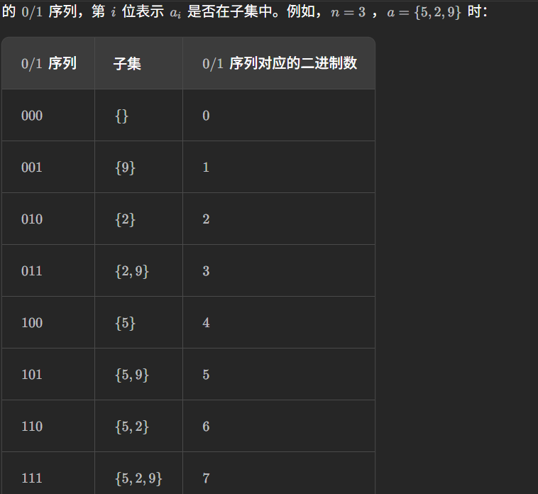

# 记录
- 题目:
  给你一个整数数组 nums ，数组中的元素 互不相同 。返回该数组所有可能的子集（幂集）。
  解集 不能 包含重复的子集。你可以按 任意顺序 返回解集。
- 示例:
  示例 1：
  `输入：nums = [1,2,3]`
  `输出：[[],[1],[2],[1,2],[3],[1,3],[2,3],[1,2,3]]`
  示例 2：
  `输入：nums = [0]`
  `输出：[[],[0]]`
- 思路:
  这题做了超级久,一开始想着按照"全排列"那题的做法,但是无论是记录一个个元素加起来,还是记录删去元素,都会产生重复,比如1,3和2,3他们都会再产生1,2,3.
  于是我想着直接转换为集合来试试,然后超时了.
  最后,我注意到原来那种方式是排列的所有情况,而示例里是升序的.我想到可以手动只取升序的情况(每种集合的升序都只有一种).依旧用填空的方式.
  只有待选元素>已选元素的最后一个的时候,才进行交换.
  用切片来获取不同大小的子集.
  最后记得加上空集合.
- 代码:
  ```cpp
  class Solution {
  public:
      vector<vector<int>> subsets(vector<int>& nums) {
          vector<vector<int>> res;
          tool(nums,res,0);
          res.emplace_back();
          return res;
      }
      void tool(vector<int>& nums,vector<vector<int>>& res,int first){
          if(first==nums.size()){
            return;
          }
          //first及以前是选取的
          for(int i = first;i<nums.size();i++){
              if((first-1>=0&&nums[i]>=nums[first-1])||first == 0){
                  swap(nums[i],nums[first]);
                  vector<int> sub(nums.begin(),nums.begin()+first+1);
                  res.emplace_back(sub);
                  tool(nums,res,first+1);
                  swap(nums[i],nums[first]);
              }

          }

      }
  };
  ```
- 结果:
  时间100,空间50
- 题解的做法1(使用二进制来表示选取)
  代码:
  ```cpp
  class Solution {
  public:
      vector<int> t;
      vector<vector<int>> ans;

      vector<vector<int>> subsets(vector<int>& nums) {
          int n = nums.size();
          for (int mask = 0; mask < (1 << n); ++mask) {
              t.clear();
              for (int i = 0; i < n; ++i) {
                  if (mask & (1 << i)) {
                      t.push_back(nums[i]);
                  }
              }
              ans.push_back(t);
          }
          return ans;
      }
  };
  ```
  - 解析:
    因为有n个数嘛,本质上是要选取其中不重复的数.使用二进制来标记,有n个数就使用n个位,然后话不多说,看图.
    
    ```for (int mask = 0; mask < (1 << n); ++mask) ```
    循环$2^n$,mask的二进制写法就是选取情况,绝对不会有重复.
    ```cpp
    for (int i = 0; i < n; ++i) {
        if (mask & (1 << i)) {
            t.push_back(nums[i]);
        }
    }
    ```
    对每一个数判断是否选取.
    这种方法要求n不能太大
- 题解的方法2(递归实现)
  代码:
  ```cpp
  class Solution {
  public:
      vector<int> t;
      vector<vector<int>> ans;

      void dfs(int cur, vector<int>& nums) {
          if (cur == nums.size()) {
              ans.push_back(t);
              return;
          }
          t.push_back(nums[cur]);
          dfs(cur + 1, nums);
          t.pop_back();
          dfs(cur + 1, nums);
      }

      vector<vector<int>> subsets(vector<int>& nums) {
          dfs(0, nums);
          return ans;
      }
  };
  ```
  - 这个太复杂了,故此复制评论区的解释
    ```
    []
    ├── [1]
    │ ├── [1, 2]
    │ │ ├── [1, 2, 3]
    │ │ │ ├── [1, 2, 3, 4]
    │ │ │ │ ├── [1, 2, 3, 4, 5]//cur = 4,dfs记录
    │ │ │ │ └── 回溯到 [1, 2, 3, 4]//这里是第二个dfs,cur依旧是4,然后再次dfs记录.
    │ │ │ ├── [1, 2, 3, 5]//这里是先回到原先的1,2,3,4.cur=3, pop_back后变成1,2,3,然后dfs得到[1,2,3,4],cur=4,记录
    │ │ │ └── 回溯到 [1, 2, 3]//继续上面,cur还是=4,pop_back变成1,2,3,第二个dfs记录
    │ │ ├── [1, 2, 4]//回到原先的1,2,3,cur = 2,pop_back后变成1,2,进入第二个dfs后得到1,2,4,cur = 3.
    │ │ │ ├── [1, 2, 4, 5]//继续递归,cur =4,记录
    │ │ │ └── 回溯到 [1, 2, 4]//回溯,cur还是 4,进入第二个dfs,记录
    │ │ ├── [1, 2, 5]
    │ │ └── 回溯到 [1, 2]
    │ ├── [1, 3]
    │ │ ├── [1, 3, 4]
    │ │ │ ├── [1, 3, 4, 5]
    │ │ │ └── 回溯到 [1, 3, 4]
    │ │ ├── [1, 3, 5]
    │ │ └── 回溯到 [1, 3]
    │ ├── [1, 4]
    │ │ ├── [1, 4, 5]
    │ │ └── 回溯到 [1, 4]
    │ ├── [1, 5]
    │ └── 回溯到 [1]
    ├── [2]
    │ ├── [2, 3]
    │ │ ├── [2, 3, 4]
    │ │ │ ├── [2, 3, 4, 5]
    │ │ │ └── 回溯到 [2, 3, 4]
    │ │ ├── [2, 3, 5]
    │ │ └── 回溯到 [2, 3]
    │ ├── [2, 4]
    │ │ ├── [2, 4, 5]
    │ │ └── 回溯到 [2, 4]
    │ ├── [2, 5]
    │ └── 回溯到 [2]
    ├── [3]
    │ ├── [3, 4]
    │ │ ├── [3, 4, 5]
    │ │ └── 回溯到 [3, 4]
    │ ├── [3, 5]
    │ └── 回溯到 [3]
    ├── [4]
    │ ├── [4, 5]
    │ └── 回溯到 [4]
    ├── [5]
    └── 回溯到 []
    ```
  - 解析:
    这个做法太过于复杂,我的脑袋要炸了,忽略它吧.
- 他人的做法
  代码:
  ```java
  class Solution {
      public List<List<Integer>> subsets(int[] nums) {
          List<List<Integer>> res = new ArrayList<>();
          res.add(new ArrayList<>());
          for (int i = 0; i < nums.length; i++) {
            int all = res.size();
              for (int j = 0; j < all; j++) {
                  List<Integer> tmp = new ArrayList<>(res.get(j));
                  tmp.add(nums[i]);
                  res.add(tmp);
              }
          }
          return res;
      }
  }
  ```
  - 解析:
    这个的做法是对已有集合进行操作.每次插入的都是新元素,故而不会重复.
    每次都是翻倍,恰好是$2^n$.
    如`[1,2,3,4]`
    ```
    初始:[]
    [],[1]
    [],[1],[2],[1,2]
    [],[1],[2],[1,2],[3],[1,3],[2,3],[1,2,3],
    [],[1],[2],[1,2],[3],[1,3],[2,3],[1,2,3],[4],[1,4],[2,4],[1,2,4],[3,4],[1,3,4],[2,3,4],[1,2,3,4]
    ```
