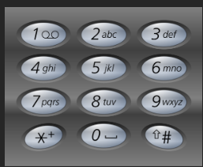

# 记录
- 题目：
  给定一个仅包含数字 2-9 的字符串，返回所有它能表示的字母组合。答案可以按 任意顺序 返回。
  给出数字到字母的映射如下（与电话按键相同）。注意 1 不对应任何字母。
  
- 示例：
  示例 1：
  `输入：digits = "23"`
  `输出：["ad","ae","af","bd","be","bf","cd","ce","cf"]`
  示例 2：
  `输入：digits = "2"`
  `输出：["a","b","c"]`
- 思路
  注意这题是不同集合之间的映射方式，而不是像之前那样的子集了，长度固定为digitals的长度。
  于是更简单，先准备好数字到对应字符串的映射，然后一个个遍历，选取所有可能的字符，然后下一位，直到cur与digitals大小相同则存储。
  返回时要回溯。
- 代码：
  ```cpp
  class Solution {
  public:
      map<char,string> m{
          {'2', "abc"},
          {'3', "def"},
          {'4', "ghi"},
          {'5', "jkl"},
          {'6', "mno"},
          {'7', "pqrs"},
          {'8', "tuv"},
          {'9', "wxyz"}
      };
      vector<string> con;
      vector<string> letterCombinations(string digits) {
          string s;
          tool(s,digits,0);
          return con;

      }
      void tool(string& str,string& digits,int cur){
          if(cur == digits.size()){
              con.emplace_back(str);
              return;
          }
          for(int i = 0;i<m[digits[cur]].size();i++){
              str+=m[digits[cur]][i];
              tool(str,digits,cur+1);
              str.pop_back();

          }
      }
  };
  ```
- 结果：
  时间100，空间35
  就是这样做，没什么好说的。
- 新知识
  ==""不能直接作为参数传给string形参，因为他是const char*类型，所有最好是新建一个string变量再传递==
  ==map初始化方式见上面代码==
