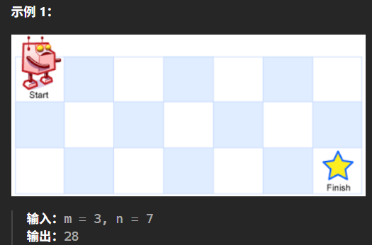

# 记录
---
- 题目:
  一个机器人位于一个 m x n 网格的左上角 （起始点在下图中标记为 “Start” ）。
  机器人每次只能向下或者向右移动一步。机器人试图达到网格的右下角（在下图中标记为 “Finish” ）。
  问总共有多少条不同的路径？
- 示例
  
---
- 思路：
  看注释，这题简单
- 代码：
  ```cpp
  class Solution {
  public:
      int uniquePaths(int m, int n) {
          vector<vector<int>> board(m,vector<int>(n,0));
          board[0][0] = 1;
          //f(i,j)表示到达i,j的路径数
          //f(i,j) = f(i-1,j)+f(i,j-1);
          //这个一定得逐行或逐列扫描,才能确保前面的存在
          for(int i = 0;i<m;i++){
              for(int j = 0;j<n;j++){
                  if(i-1>=0){
                      board[i][j] += board[i-1][j];
                  }
                  if(j-1>=0){
                      board[i][j] += board[i][j-1];
                  }
              }
          }
          return board[m-1][n-1];
      }
  };
  ```
- 结果:
  时间19,空间38
---
- 题解的优化
  此外，由于 f(i,j) 仅与第 i 行和第 i−1 行的状态有关，因此我们可以使用滚动数组代替代码中的二维数组，使空间复杂度降低为 O(n)。
- 代码:
  ```cpp
  class Solution {
  public:
      int uniquePaths(int m, int n) {
          vector<int> f(n,1);
          for (int i = 1; i < m; ++i) {
              for (int j = 1; j < n; ++j) {
                  f[j]+=f[j-1];
              }
          }
          return f[n - 1];
      }
  };
  ```