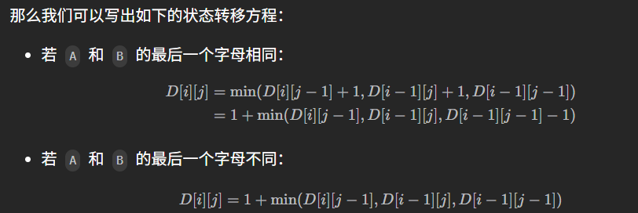

# 记录
---
- 题目:
  给你两个单词 word1 和 word2， 请返回将 word1 转换成 word2 所使用的最少操作数  。
  你可以对一个单词进行如下三种操作：
  插入一个字符
  删除一个字符
  替换一个字符
- 示例:
  示例 1：
  输入：word1 = "horse", word2 = "ros"
  输出：3
  解释：
  horse -> rorse (将 'h' 替换为 'r')
  rorse -> rose (删除 'r')
  rose -> ros (删除 'e')
  示例 2：
  输入：word1 = "intention", word2 = "execution"
  输出：5
  解释：
  intention -> inention (删除 't')
  inention -> enention (将 'i' 替换为 'e')
  enention -> exention (将 'n' 替换为 'x')
  exention -> exection (将 'n' 替换为 'c')
  exection -> execution (插入 'u')
---
- 思路:
  吾尝终日而思矣，不如须臾之所学也
  这题想了会,不像是我能做出来的题.
  背吧
---
- 思路
  dp定义为dp[i][j] = A 的前 i 个字母和 B 的前 j 个字母之间的最小编辑距离。
  对A进行删除和对B进行添加是等效的
  这样以来，本质不同的操作实际上只有三种：
  - 在单词 A 中插入一个字符；
  - 在单词 B 中插入一个字符；
  - 修改单词 A 的一个字符。

  我们用 A = horse，B = ros 作为例子，来看一看是如何把这个问题转化为规模较小的若干子问题的。
  - 在单词 A 中插入一个字符：如果我们知道 horse 到 ro 的编辑距离为 a，那么显然 horse 到 ros 的编辑距离不会超过 a + 1。这是因为我们可以在 a 次操作后将 horse 和 ro 变为相同的字符串，只需要额外的 1 次操作，在单词 A 的末尾添加字符 s，就能在 a + 1 次操作后将 horse 和 ro 变为相同的字符串；
  - 在单词 B 中插入一个字符：如果我们知道 hors 到 ros 的编辑距离为 b，那么显然 horse 到 ros 的编辑距离不会超过 b + 1，原因同上；(只需要ros编辑为hors,然后加一个字符e就好)
  - 修改单词 A 的一个字符：如果我们知道 hors 到 ro 的编辑距离为 c，那么显然 horse 到 ros 的编辑距离不会超过 c + 1，原因同上。(只需要将hors编辑为ro,然后把e改成s就好)
  
  如上所述，当我们获得 D[i][j-1]，D[i-1][j] 和 D[i-1][j-1] 的值之后就可以计算出 D[i][j]。
  - D[i][j-1] 为 A 的前 i 个字符和 B 的前 j - 1 个字符编辑距离的子问题。即对于 B 的第 j 个字符，我们在 A 的末尾添加了一个相同的字符，那么 D[i][j] 最小可以为 D[i][j-1] + 1；
  - D[i-1][j] 为 A 的前 i - 1 个字符和 B 的前 j 个字符编辑距离的子问题。即对于 A 的第 i 个字符，我们在 B 的末尾添加了一个相同的字符，那么 D[i][j] 最小可以为 D[i-1][j] + 1；
  - D[i-1][j-1] 为 A 前 i - 1 个字符和 B 的前 j - 1 个字符编辑距离的子问题。即对于 B 的第 j 个字符，我们修改 A 的第 i 个字符使它们相同，那么 D[i][j] 最小可以为 D[i-1][j-1] + 1。**特别地**，如果 A 的第 i 个字符和 B 的第 j 个字符原本就相同，那么我们实际上不需要进行修改操作。在这种情况下，D[i][j] 最小可以为 D[i-1][j-1]。
  
  
  ==其实我还是不太理解==
- 代码:
  ```cpp
  class Solution {
      public int minDistance(String word1, String word2) {
          int n = word1.length();
          int m = word2.length();

          // 有一个字符串为空串
          if (n * m == 0) {
              return n + m;
          }

          // DP 数组
          int[][] D = new int[n + 1][m + 1];

          // 边界状态初始化
          for (int i = 0; i < n + 1; i++) {
              D[i][0] = i;
          }
          for (int j = 0; j < m + 1; j++) {
              D[0][j] = j;
          }

          // 计算所有 DP 值
          for (int i = 1; i < n + 1; i++) {
              for (int j = 1; j < m + 1; j++) {
                  int left = D[i - 1][j] + 1;
                  int down = D[i][j - 1] + 1;
                  int left_down = D[i - 1][j - 1];
                  if (word1.charAt(i - 1) != word2.charAt(j - 1)) {
                      left_down += 1;
                  }
                  D[i][j] = Math.min(left, Math.min(down, left_down));
              }
          }
          return D[n][m];
      }
  }
  ```
- 解析
  这里依旧定义为m+1*n+1
  i或j为0表示对比空串，其值就是等于不为0的另一个数，因为要全删