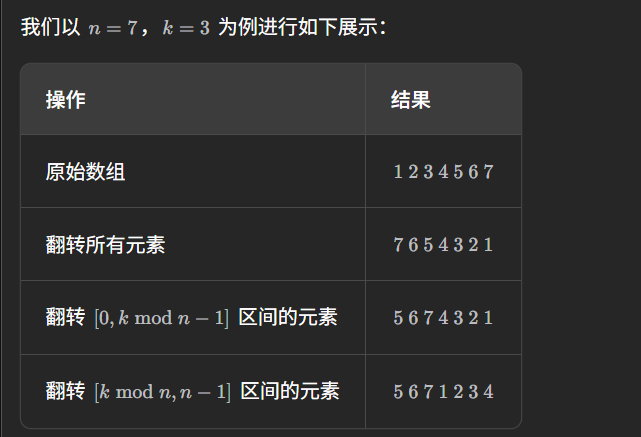

# 记录
---
- 题目:
  给定一个整数数组 nums，将数组中的元素向右轮转 k 个位置，其中 k 是非负数。
  提示：
  1 <= nums.length <= 105
  -231 <= nums[i] <= 231 - 1
  0 <= k <= 105
  进阶：
  尽可能想出更多的解决方案，至少有 三种 不同的方法可以解决这个问题。
  你可以使用空间复杂度为 O(1) 的 原地 算法解决这个问题吗？
- 示例:
  示例 1:
  输入: nums = [1,2,3,4,5,6,7], k = 3
  输出: [5,6,7,1,2,3,4]
  解释:
  向右轮转 1 步: [7,1,2,3,4,5,6]
  向右轮转 2 步: [6,7,1,2,3,4,5]
  向右轮转 3 步: [5,6,7,1,2,3,4]
  示例 2:
  输入：nums = [-1,-100,3,99], k = 2
  输出：[3,99,-1,-100]
  解释: 
  向右轮转 1 步: [99,-1,-100,3]
  向右轮转 2 步: [3,99,-1,-100]
---
- 思路:
  轮转k步就是向右移动k % nums.size()步,后续仍以k表示
  从首位开始,移动到右移k步所在位置,然后该位置也右移k步,如此循环
  如果k是nums.size()的原根,则只要从0出发,就会换完全部
  但是不一定是原根
  于是只对前k个元素作为首位出发,进行移动.
  这期间一定会有重复的,于是使用一个集合来记录已经被插入正确数的位置
- 代码:
  ```cpp
  class Solution {
  public:
      void rotate(vector<int>& nums, int k) {
          int cur = 0;
          int next = 0;
          int tem1;
          int tem2;
          k %= nums.size();
          set<int> rem;
          for(int i = 0;i<k;i++){
              tem2 = nums[i];
              cur = i;
              if(rem.count(cur)) continue;
              while(true){
                  if(rem.count(cur)) break;
                  else{
                      rem.insert(cur);
                  }
                  next = (cur + k)%nums.size();
                  tem1 = nums[next];
                  nums[next] = tem2;
                  tem2 = tem1;
                  cur = next;
              }
          }
      }
  };
  ```
- 结果
  时间5,空间5
---
**题解的思路二(环状替换)**
- 思路
  和我的类似,只不过,它给出了需要作为首位的是哪些,也就是只要对前gcd(k,nums.size())个元素开始交替更换就好
  此外,它用一个swap函数,来直接把当前元素替换为上一个,并保存当前元素
- 代码:
  ```cpp
  class Solution {
  public:
      void rotate(vector<int>& nums, int k) {
          int n = nums.size();
          k = k % n;
          int count = gcd(k, n);
          for (int start = 0; start < count; ++start) {
              int current = start;
              int prev = nums[start];
              do {
                  int next = (current + k) % n;
                  swap(nums[next], prev);
                  current = next;
              } while (start != current);
          }
      }
  };
  ```
---
**题解的思路三(数组翻转)**
- 思路:
  该方法基于如下的事实：当我们将数组的元素向右移动 k 次后，尾部 kmodn 个元素会移动至数组头部，其余元素向后移动 kmodn 个位置。
  该方法为数组的翻转：我们可以先将所有元素翻转，这样尾部的 kmodn 个元素就被移至数组头部，然后我们再翻转 [0,kmodn−1] 区间的元素和 [kmodn,n−1] 区间的元素即能得到最后的答案。
  翻转三次一共
- 例子：
  
- 代码：
  ```cpp
  class Solution {
  public:
      void reverse(vector<int>& nums, int start, int end) {
          while (start < end) {
              swap(nums[start], nums[end]);
              start += 1;
              end -= 1;
          }
      }

      void rotate(vector<int>& nums, int k) {
          k %= nums.size();
          reverse(nums, 0, nums.size() - 1);
          reverse(nums, 0, k - 1);
          reverse(nums, k, nums.size() - 1);
      }
  };

  ```
- 复杂度分析
  时间复杂度：O(n)，其中 n 为数组的长度。每个元素被翻转两次，一共 n 个元素，因此总时间复杂度为 O(2n)=O(n)。
  空间复杂度：O(1)。