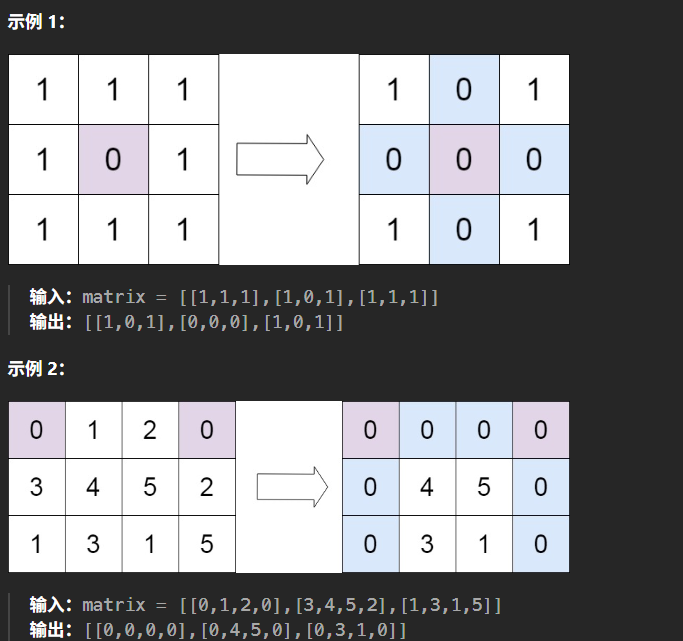

# 记录
---
- 题目
  给定一个 m x n 的矩阵，如果一个元素为 0 ，则将其所在行和列的所有元素都设为 0 。请使用 原地 算法。
  进阶：
  一个直观的解决方案是使用  O(mn) 的额外空间，但这并不是一个好的解决方案。
  一个简单的改进方案是使用 O(m + n) 的额外空间，但这仍然不是最好的解决方案。
  你能想出一个仅使用常量空间的解决方案吗？
- 示例
  
---
- 思路
  直接遍历一遍，记录0所在位置的行与列
  然后再遍历，把记录的行，列全部置零
- 代码：
  ```cpp
  class Solution {
  public:
      void setZeroes(vector<vector<int>>& matrix) {
          vector<int> col;
          vector<int> row;
          for(int i = 0;i<matrix.size();i++){
              for(int j = 0;j<matrix[i].size();j++){
                  if(matrix[i][j]==0){
                      col.emplace_back(j);
                      row.emplace_back(i);
                  }
              }

          }
          for(int i = 0;i<row.size();i++){
              for(int j = 0;j<matrix[0].size();j++){
                  matrix[row[i]][j] = 0;
              }
          }
          for(int i = 0;i<col.size();i++){
              for(int j = 0;j<matrix.size();j++){
                  matrix[j][col[i]] = 0;
              }
          }
      }
  };
  ```
- 结果:
  时间5,空间5
  时间复杂度O(mn)
  空间复杂度O(m+n)
---
**题解的做法二(使用两个标记变量)**
- 思路:
  因为如果某一行有了0,那么对应的第一列就会要置零
  如果某一列有了0,对应的第一行也要置零
  于是可以利用矩阵本身的空间
  取矩阵的第一列和第一行
  遍历除去第一列,第一行的元素
  如果遇到0,把它对应的第一列第一行的元素置为0
  然后再遍历一遍除第一行第一列的元素,看看它对应的第一列第一行有没有一个是0,有则置零
  此外,还需要两个变量,来记录第一列,第一行是不是本身有0
  有的话,把第一列/第一行置零
  那两个变量就是唯一额外使用的
- 代码:
  ```cpp
  class Solution {
  public:
      void setZeroes(vector<vector<int>>& matrix) {
          int m = matrix.size();
          int n = matrix[0].size();
          int flag_col0 = false, flag_row0 = false;
          for (int i = 0; i < m; i++) {
              if (!matrix[i][0]) {
                  flag_col0 = true;
              }
          }
          for (int j = 0; j < n; j++) {
              if (!matrix[0][j]) {
                  flag_row0 = true;
              }
          }
          for (int i = 1; i < m; i++) {
              for (int j = 1; j < n; j++) {
                  if (!matrix[i][j]) {
                      matrix[i][0] = matrix[0][j] = 0;
                  }
              }
          }
          for (int i = 1; i < m; i++) {
              for (int j = 1; j < n; j++) {
                  if (!matrix[i][0] || !matrix[0][j]) {
                      matrix[i][j] = 0;
                  }
              }
          }
          if (flag_col0) {
              for (int i = 0; i < m; i++) {
                  matrix[i][0] = 0;
              }
          }
          if (flag_row0) {
              for (int j = 0; j < n; j++) {
                  matrix[0][j] = 0;
              }
          }
      }
  };
  ```
- 复杂度分析
  时间O(mn),空间O(1)
---
**题解的做法三(使用一个标记变量)**
- 思路
  我们可以对方法二进一步优化，只使用一个标记变量记录第一列是否原本存在 0。这样，第一列的第一个元素即可以标记第一行是否出现 0。但为了防止每一列的第一个元素被提前更新，我们需要从最后一行开始，倒序地处理矩阵元素。
- 代码:
  ```cpp
  class Solution {
  public:
      void setZeroes(vector<vector<int>>& matrix) {
          int m = matrix.size();
          int n = matrix[0].size();
          int flag_col0 = false;
          for (int i = 0; i < m; i++) {
              if (!matrix[i][0]) {
                  flag_col0 = true;
              }
              for (int j = 1; j < n; j++) {
                  if (!matrix[i][j]) {
                      matrix[i][0] = matrix[0][j] = 0;
                  }
              }
          }
          for (int i = m - 1; i >= 0; i--) {
              for (int j = 1; j < n; j++) {
                  if (!matrix[i][0] || !matrix[0][j]) {
                      matrix[i][j] = 0;
                  }
              }
              if (flag_col0) {
                  matrix[i][0] = 0;
              }
          }
      }
  };
  ```
- 复杂度
  时间O(mn),空间O(n)
- 解释
  最后倒着遍历是为了规范，因为其实是按行检查。
  最后会回到第一行，同时检查第一个元素是不是0，更新第一行
  第一行要最后更新，因为第一行本身也作为参照