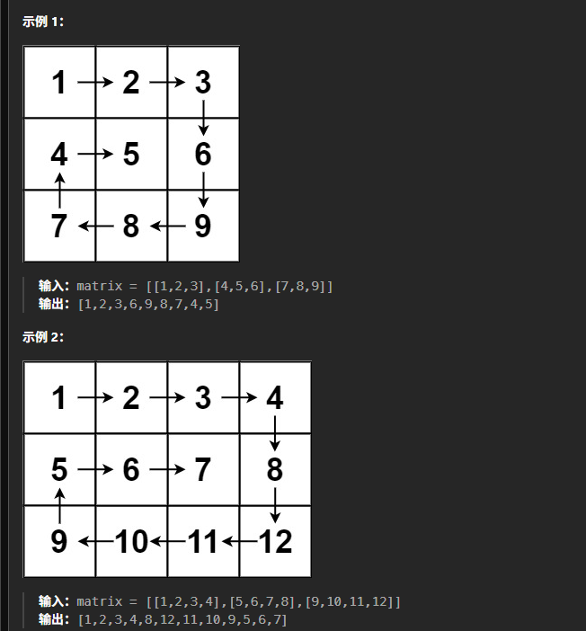

# 记录
---
- 题目:
  给你一个 m 行 n 列的矩阵 matrix ，请按照 顺时针螺旋顺序 ，返回矩阵中的所有元素。
- 示例:
  
---
- 思路
  因为做过，所以明白，这题就是把这种螺旋操作规范化，一层一层剥开
  于是写一个工具函数，螺旋的读取最外层的情况
- 代码：
  ```cpp
  class Solution {
  public:
      vector<int> ret;
      vector<int> spiralOrder(vector<vector<int>>& matrix) {
          vector<int> lt(2);
          vector<int> rd(2);
          lt[0] = 0;
          lt[1] = 0;
          rd[0] = matrix.size()-1;
          rd[1] = matrix[0].size()-1;
          while(lt[0]<=rd[0]&&lt[1]<=rd[1]){
              tool(matrix,lt,rd);
              lt[0]++;
              lt[1]++;
              rd[0]--;
              rd[1]--;
          }
          return ret;
      }
      void tool(vector<vector<int>>& matrix,vector<int>& lt,vector<int>& rd){
          if(lt[0] == rd[0]){
              for(int i = lt[1];i<=rd[1];i++){
                  ret.emplace_back(matrix[lt[0]][i]);
              }

          }
          else if(lt[1] == rd[1]){
              for(int i = lt[0];i<=rd[0];i++){
                  ret.emplace_back(matrix[i][lt[1]]);
              }
          }
          else{
              for(int i = lt[1];i<rd[1];i++){
                  ret.emplace_back(matrix[lt[0]][i]);
              }
              for(int i = lt[0];i<rd[0];i++){
                  ret.emplace_back(matrix[i][rd[1]]);
              }
              for(int i = rd[1];i>lt[1];i--){
                  ret.emplace_back(matrix[rd[0]][i]);
              }
              for(int i = rd[0];i>lt[0];i--){
                  ret.emplace_back(matrix[i][lt[1]]);
              }
          }
      }
  };
  ```
- 结果:
  时间100,空间22
---
**题解的方法二(按层模拟)**
- 思路
  和我的差不多,但是它有提到
  对于每层:
  - 从左上方开始以顺时针的顺序遍历所有元素。假设当前层的左上角位于 (top,left)，右下角位于 (bottom,right)，按照如下顺序遍历当前层的元素。
    从左到右遍历上侧元素，依次为 (top,left) 到 (top,right)。
    从上到下遍历右侧元素，依次为 (top+1,right) 到 (bottom,right)。
    ==如果 `left<right` 且 `top<bottom`，则从右到左遍历下侧元素，依次为 (bottom,right−1) 到 (bottom,left+1)，以及从下到上遍历左侧元素，依次为 (bottom,left) 到 (top+1,left)。==

  这是防止只有一行/一列的层重复读取的方法
  另外,这里用了循环来代替函数
- 代码:
  ```cpp
  class Solution {
  public:
      vector<int> spiralOrder(vector<vector<int>>& matrix) {
          if (matrix.size() == 0 || matrix[0].size() == 0) {
              return {};
          }

          int rows = matrix.size(), columns = matrix[0].size();
          vector<int> order;
          int left = 0, right = columns - 1, top = 0, bottom = rows - 1;
          while (left <= right && top <= bottom) {
              for (int column = left; column <= right; column++) {
                  order.push_back(matrix[top][column]);
              }
              for (int row = top + 1; row <= bottom; row++) {
                  order.push_back(matrix[row][right]);
              }
              if (left < right && top < bottom) {
                  for (int column = right - 1; column > left; column--) {
                      order.push_back(matrix[bottom][column]);
                  }
                  for (int row = bottom; row > top; row--) {
                      order.push_back(matrix[row][left]);
                  }
              }
              left++;
              right--;
              top++;
              bottom--;
          }
          return order;
      }
  };
  ```
- 复杂度分析
  时间O(mn),空间O(1),不使用除了输出的额外空间