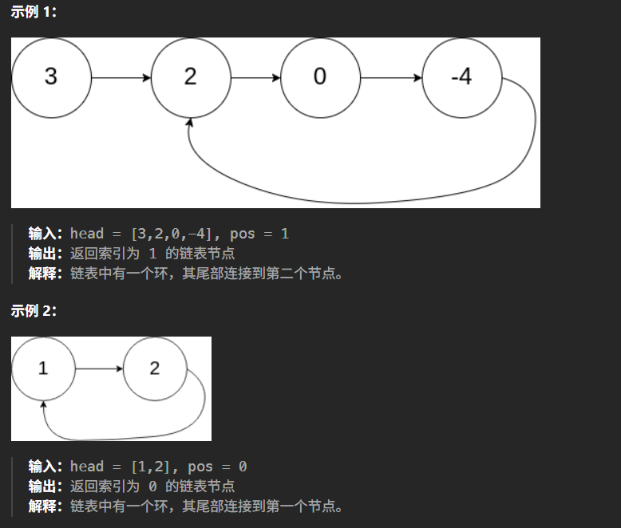

# 记录
---
- 题目:
  给定一个链表的头节点  head ，返回链表开始入环的第一个节点。 如果链表无环，则返回 null。
  如果链表中有某个节点，可以通过连续跟踪 next 指针再次到达，则链表中存在环。 为了表示给定链表中的环，评测系统内部使用整数 pos 来表示链表尾连接到链表中的位置（索引从 0 开始）。如果 pos 是 -1，则在该链表中没有环。注意：pos 不作为参数进行传递，仅仅是为了标识链表的实际情况。
  不允许修改 链表。
- 示例:
  
---
- 思路
  非常经典的一题，就是快慢指针，先让快慢指针从头出发，快指针一次移动两个（注意不能使用空指针），慢指针一次移动一个。
  当他们相遇，说明有环
  此时，使用一个新的指针，让他从头开始移动，和慢指针同步，都是一次移动一格
  当他们相遇，此时位于环的入口处
- 代码：
  ```cpp
    /**
  * Definition for singly-linked list.
  * struct ListNode {
  *     int val;
  *     ListNode *next;
  *     ListNode(int x) : val(x), next(NULL) {}
  * };
  */
  class Solution {
  public:
      ListNode *detectCycle(ListNode *head) {
          ListNode* slow = head;
          ListNode* fast = head;
          if(head == NULL) return NULL;
          if(head->next == NULL) return NULL;
          while(true){
              slow = slow->next;
              if(fast->next == NULL) return NULL;
              fast = fast->next->next;
              if(fast == NULL) return NULL;
              if(slow == fast) break;
          }
          fast = head;
          while(slow!=fast){
              slow = slow->next;
              fast = fast->next;
          }
          return slow;

      }
  };
  ```
- 结果
  时间22,空间42
---
**题解的做法二(快慢指针)**
- 代码:
  ```cpp
  class Solution {
  public:
      ListNode *detectCycle(ListNode *head) {
          ListNode *slow = head, *fast = head;
          while (fast != nullptr) {
              slow = slow->next;
              if (fast->next == nullptr) {
                  return nullptr;
              }
              fast = fast->next->next;
              if (fast == slow) {
                  ListNode *ptr = head;
                  while (ptr != slow) {
                      ptr = ptr->next;
                      slow = slow->next;
                  }
                  return ptr;
              }
          }
          return nullptr;
      }
  };
  ```