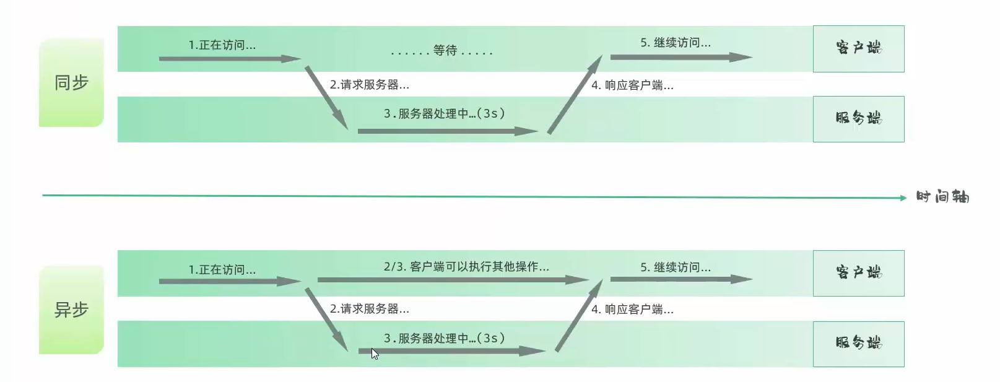

### 作用
- 数据异步交换
  在不重新加载整个页面的情况下,与服务器交换数据并更新部分网页
- 同步与异步的区别
  
### Axios
- 是什么
  对原生的Ajax进行了封装,简化书写,快速开发
#### 基本语法
- axios函数
  一般把事件绑定到axios函数
 ```html
 axios({
  method:'请求方式'
  url:'请求地址'
 }).then(
  (result)=>{
    <!-- 成功时做什么 -->
  }
 ).catch(
  (err)=>{
    <!-- 失败时做什么 -->
  }
 )
 ```
- 说明
  axios函数会返回一个对象,有方法then
  axios的参数是一个对象
  then和catch方法的参数则是一个函数
  axios参数的对象里的元素包括
  ```
  {
    method:GET/POST
    url:
    data:POST方式的请求数据
    params:发送请求时携带的url参数
  }
  ```
  传入的实参是报文整体,是一个类,包括响应码之类的.
  对于返回的正确结果,其内容在data成员里
  POST方式里没有data
- 简化写法
  axios.请求方式(url,data,config).then().catch()

