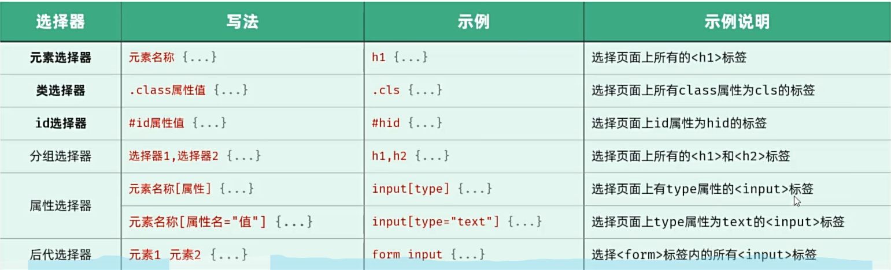
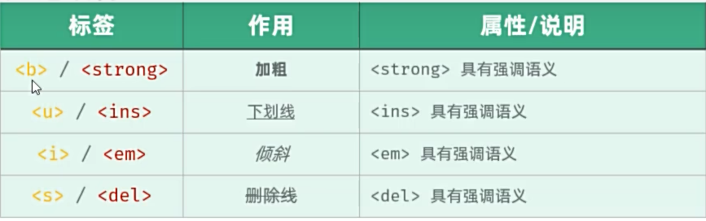
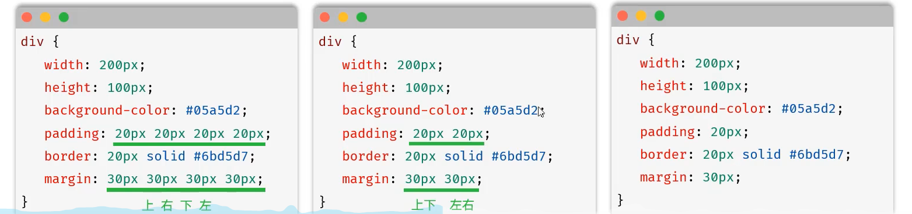
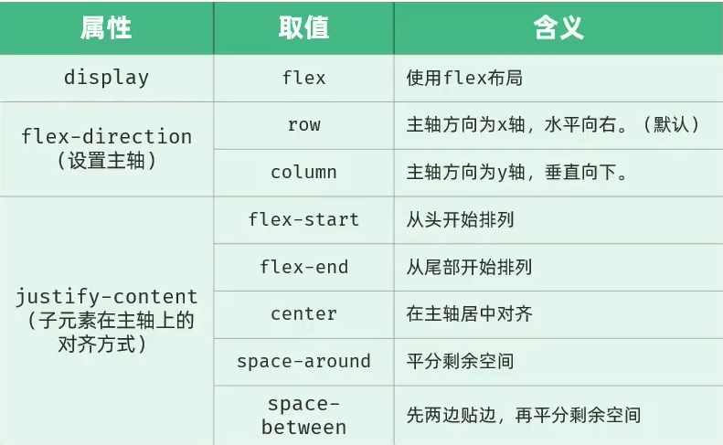
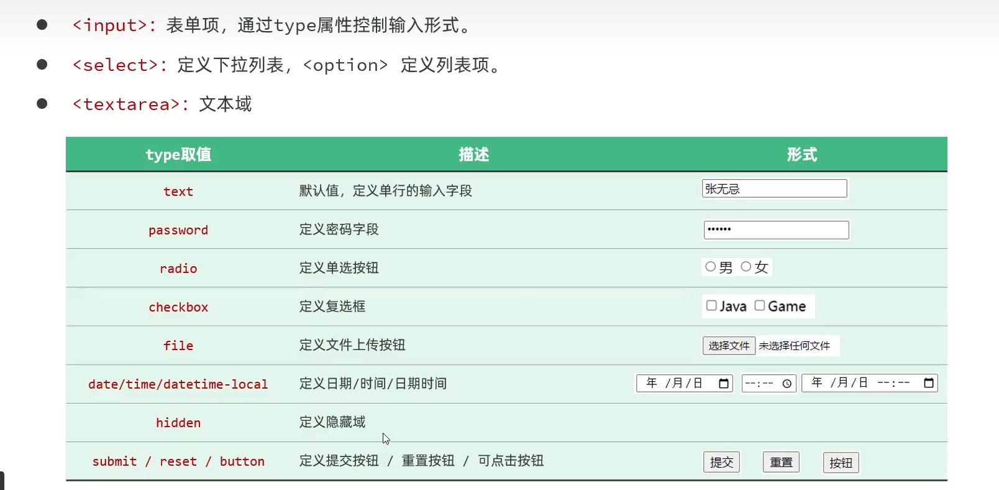

### span标签
**`<span>` 是行内元素（inline）**，用来给**一小段文字、部分内容**单独加样式、标记，本身没有默认样式，不会自动换行。
例如：
  ```
  <p>
  今天
  <span style="color:red;">天气很好</span>
  ！
  </p>
  ```

### CSS的引入方式
- 行内
  如
  ```html
  <span style="color:red;">天气很好</span>
  ```
- 内部(整个页面复用)
  如
  ```html
  <style>
    span{
      color:red
    }
  </style>
  <span>天气很好</span>
  ```

- 外部(引入css文件)
  ```html
  <head>
  <link rel = "stylesheet" href ="css/test1.css">
  </head>
  <span>天气很好</span>
  ```

  ```
  rel表示引入的是一个样式表,即css文件
  href表示引入的文件地址
  ```
### 颜色表示
- 英文表示
  如color:red
- RGB
  如color:rgb(18, 19, 20)
- RGBA
  如color:rgba(255, 204, 65,0)
  a表示不透明度,取值0-1
### 选择器
- 元素选择器
  如
  ```html
  span{
    color:red
  }
  ```
- 类选择器
  如
  ```html
  .class_name{


  }
  ```
  .就表示是类,后面跟类名
  <span class = "class_name">天气很好</span>
- id选择器
  如
  ```html
  #id_name{

  }
  ```
  #表示id,后面跟id名
  <span id = "id_name">天气很好</span>
- 优先级
  id>class>元素
- 要放在style里
- 其他
  
### video标签
- 示例
  <video src="video/news.mp4" controls autoplay width = "80%"></video>
  - 说明:
    src=地址
    autoplay,表示自动播放,去掉就不会
    controls,显示播放控件,基本必需
    width = 宽度
    height = 高度
    单位，px像素，%相对于父元素的百分比
    宽度和高度只设置一个就好，另一个会根据视频文件比例等比例缩放

### 换行标签
<br>

### 音频标签
- 示例
  <audio src="audio/news.mp3" controls></audio>

### 段落标签
- 示例
  <p>这是一段话</p>
  <p>这是另一段话</p>
- 说明
  会独占一块,段落之间的空隙由margin决定
- 样式设置
  line-height:n;表示行高为n被行间距 
  text-indent:nem;表示首行缩进n个字符,em是单位
### 图片标签
- 示例
  </img>
- 说明
  路径可以是本机的绝对/相对路径,也可以是网络的路径
### 文本修饰标签

### 空格字符
&nbsp;&nbsp;&nbsp;&nbsp;这就是空格
### <>符号字符
&lt;
&gt;
### div标签
- 无语义,单纯用来划分块
- 独占一行
- 怎么用来排版
  把要排版的部分全放进一个大div里,给上id
  用CSS来设置样式
### 居中
样式设置为
margin-left:auto;
margin-right:auto;
### 盒子模型
- 组成
  从内到外四部分
  内容区域（content）、内边距区域（padding）、边框区域（border）、外边距区域（margin）
- 使用div来做盒子
  

  其中，width和height是默认是内容区域的宽高
  可以设置box-sizing：boder-box;来指定设置的是盒子大小
  border是边框,宽度,线条类型,颜色
### flex弹性布局
- 示例
  ```html
  .navbar{
    background-color: grey;
    display:flex;/* flex弹性布局*/
    justify-content: space-between;/*左右对齐*/
    ...
  }

  <div class="navbar">
      <h1>这是左边</h1>
      <a href="...">这里是右边</a>
  </div>
  ```
- 说明
  这里的navbar是一个类型
  属于这个类的块,其里面的成员左右对齐
- 属性
  
  从尾部开始排列理解为右对齐
### form表单标签
- 示例
  ```html

  <form action="/save" method="get">
    姓名:<input type="text" name="name">
    年龄:<input type="text" name="age">
    <input type="submit" value="提交">
  </form>
  ```
- 说明
  action:提交到服务器上的哪里
  method:get(默认),post
  name属性是必需的,
  get点击提交后会访问服务器ip/save?name=姓名&age=年龄
  post请求则是在消息体或请求体中提供数据
  get方式会显示表单数据,不安全,而且容量有限制,不能传大量数据
- 表单项
  
  >下拉列表里的```<option vlaue="...">选项名</option>```
  >选中选项后上传的是value里的值
### 表格
- 示例
  ```html
  <table>
    /* 表头*/
    <thead>
      <tr>
          <th>列1名</th>
          <th>列2名</th>
          ...
      </tr>
    </thead>
    /*主体*/
    <tbody>
      /*行1*/
      <tr>
          <td></td>
          <td></td>
          ...
      </tr>
      /*行2*/
      <tr>
        ...
      </tr>
    </tbody>

  </table>
  ```