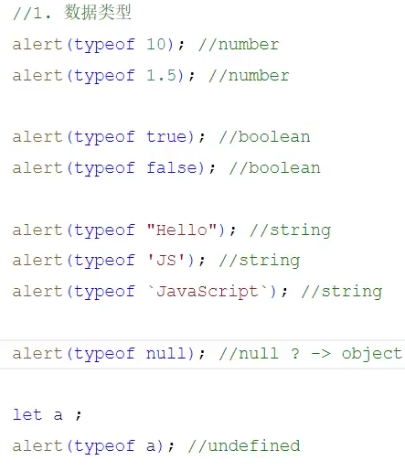
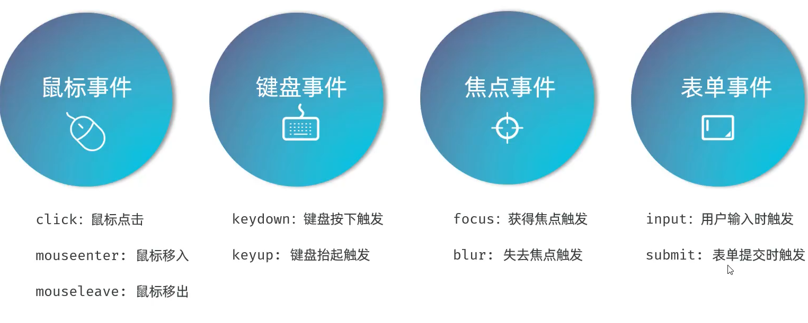

### js放在哪?
- 标签
  ```
  <script></script>
  ```
- 一般放于<body>元素的底部,可改善显示速度
- 外部脚本
  也可以把js代码定义在外部JS文件里,然后引入
  ```
  <script src="..."></script>
  ```
### 语法
- 变量声明
  let 变量名 = ?;
  >可以是不同类型
- 常量说明
  const 常量名 = ?;
  不可变
- 数据类型
  
- 模板字符串
  反引号引用
  可以简化字符串拼接
  ```js
  let name = "Tom";
  let age = 18;
  console.log(`我是${name},我今年${age}岁了`);//模板字符串
  console.log("我是"+name+"我今年"+age+"岁了");//普通拼接
  ```
  结果是一样的,正常拼接也能处理好类型
  使用模板的优势是不用写太多引号切分
- 函数
  - 基本结构
  ```js
  function 函数名(参数名1,参数名2,...){
    ...
    return ...;
  }
  ```
  - 示例
  ```js
  function add(a,b){
    return a + b;
  }
  ```
  - 定义与调用顺序
    可以先调用,后定义,执行代码时会先扫描函数
  - 匿名函数
    - 函数表达式
      ```js
      let add = function(a,b){
        return a+b;
      }
      ```
    - 箭头函数
      ```js
      let add = (a,b) => {
        return a+b;
      }
      ```
    - 说明
      这两种方式,add都是一个函数类型
      ==这种方法下不能先调用后定义==
- 类
  - 定义
    ```js
    let 对象名 = {

      属性名1:值,
      属性名2:值,
      ...
      方法名:function(形参){}

    }
    ```
  - 示例
    ```js
    let user = {
      
      name:'Tom',
      age:16,
      gender:'男',
      sing:function(){
        alert(this.name + '悠悠地唱着最炫民族风')/*不写分号也可以其实,解释器会自动补全*/
      },/*多个函数之间也要逗号隔开*/
      sing2:()=>{
        alert(this.name + '悠悠地唱着最炫民族风')
      }/*错的,所以不建议用箭头函数,此时this指向的不是user了,而是当前对象的上一级对象*/
      sing3(){
        alert(this.name + '悠悠地唱着最炫民族风')
      }/*正确的简写方法*/

    }
    alert(user.name);
    user.sing();
    ```
- json格式
  - json文件
    ```json
    {
      "key1":value1,
      "key2":value2,
      ...
    }
    ```
  - 读取之后就相当于一个字符串
    '{"key1":value1,"key2":value2,...}'
  - json格式对象与json字符串互转
    对象->字符串:JSON.stringify()
    字符串->对象:JSON.parse()
- DOM(文档对象模型)
  - 作用
    将整个HTML视作一个对象,里面的标签也是对象
    通过面向对象来操作HTML页面
  - 选择器查找
    ```js
    let h1 = document.querySelector('h1');//默认取第一个
    let h1s = document.querySelectorAll('h1');//得到的是一个数组
    let h1s1 = h1s[0];
    ```
    h1和h1s1是同一个对象
- 事件监听
  - 语法
    ```js
    事件源.addEventListener('事件类型',事件触发执行的函数);
    ```
  - 说明
    可以多次绑定同一事件
    >有个早期写法,它没法做到,后面的会覆盖之前的,所以不写出来
  - 常见事件
    
- 把一个js文件的函数导入另一个js文件
  - 语法
    import { 函数名 } from 路径
  - 说明
    被导入的函数在原js文件里前面要加export关键字，说明可以导出
  - 此时这个js文件是个高级的模块化的js文件
    导入需要做
    ```js
    <script src="..." type="module"></script>
    ```
    加上type="module"