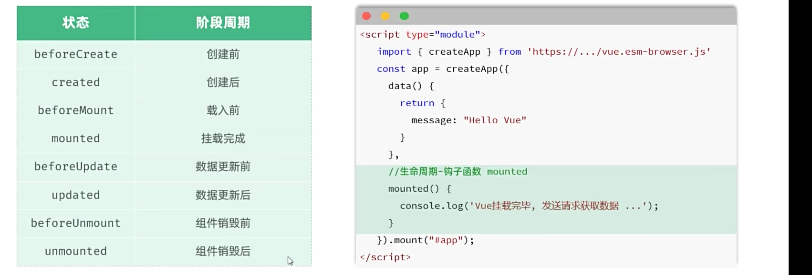

### vue是什么
### 基本语法
#### createApp
- 示例：
  ```html
  <div id="app">
  <h1>{{ message }}</h1>
  </div>
  <script type="module">
    import { createApp } from 'https://unpkg.com/vue@3/dist/vue.esm-browser.js'
    createApp({
      data() {
      return {
      message: 'Hello Vue'
      }
    }}).mount('#app');
  ```
- 说明
  因为从 CDN 地址引入 Vue 3 的浏览器 ES 模块版本，所有得加moudule
  导入的是核心函数createApp
  其基本格式为```createApp（{}）.mount();```
  mount()里填选择器，就会挂载到对应对象上
  里面那个大括号是一个js对象，第一个参数是js对象
  createApp返回的是一个vue的app对象
  data函数里返回的也是一个js对象
  div中的{{message}}的{{}}是插值语法，会解析为message对应的值，即Hello Vue
  其他地方没用，会被解释为{{message}}文本本身
#### v-for
- 作用
  让某个容器展示多次
  常用于表格，设定行的展示方式然后展出
- 示例
  见v-for.html
- 说明
  data返回的是一个对象
  其成员empList类型为列表,列表内的元素又是js对象
  v-for作用在tbody的tr对象中
  ```<tr v-for="(e,index) in empList" :key="e.id">...</tr>```
  会多次展示,index是索引,e是列表中的对象,名字随便取(不能是关键字),index从0开始
  key对于我来说一般用不上，它是给每行元素的一个唯一身份标识，便于系统对表格进行操作，不应当使用index作为key，因为当表格发生删改，行对应的key会混乱掉。使用id是因为业务中id是唯一的。**key需要给出，不然会发出警告**
#### v-bind
- 作用
  标签内部是不能直接用插值表达式的,应当用v-bind绑定,
- 示例
  见"v-for.html"
  ```html
  <td></img></td>
  ```
- 说明
  语法：`v-bind:属性名="变量/表达式"`，可简写为 `:属性名="变量/表达式"`
  `alt` 是 HTML `` 标签的**原生标准属性**，全称是 *alternate text*，即「替代文本」。它是图片标签的标配属性，核心作用是**在图片无法正常显示时，用一段文字来描述图片内容**。
- 对象式绑定
  示例等价于
  ```html
  <td></img></td>
  ...
  <!-- app里data里返回了一个对象叫image -->
  image: {
  src: 'https://xxx.jpg',
  alt: '员工头像',
  title: '点击查看详情'
  }
  ```
#### v-if,v-else-if,v-else与v-show
- 作用
  控制元素的显示与隐藏
- v-if和v-show的区别:
  v-if是条件为真才渲染,适用于能直接确定显示或不显示的场景,F12只能看到显示出来的
  v-show是条件真假都渲染,但是为真才display,使用于可能频繁显示或不显示的场景.可以在F12中发现被隐藏的
- 示例
  ```html
  <span v-if="gender == 1">男生</span>
  ```
  见"v-for.html"的job部分
- 说明
  v-else-if要在v-if后面,v-else要在更后面
  其实全用v-if也可以,不过if else的形式就会少很多判断,同时也能避免某些情况同时满足多个条件导致显示多个
#### v-model
- 作用
  双向绑定表单项的数据
- 示例
  见“v-for.html”的搜索表单区域
- 说明
  给data函数里返回的对象新增一个元素searchForm，类型为对象，其元素包括姓名，性别和职位，性别和职位用数字表示。
  这样div容器里就可以使用searchForm这个对象了
  使用v-model在input或select标签里绑定searchForm里的元素，这样在html里进行输入或选择，searchForm的元素值也会对应变化
  用插值表达式来明显的观察到变化的结果
  使用vue插件可以在浏览器中修改app对象里的searchForm的元素的值，可以观察到表单也发生变化
#### v-on
- 作用
  事件监听
- 绑定方法
  方法要放在createApp里第一个参数对象中的methods对象中，和data方法平级
  ```html
  app = createApp({
    data(){
      ...
    },
    methods:{
      方法名(){

      },

    }
  }
  )
  ```
  在标签里绑定
  ```html
  <... v-on:click="方法名"></...>
  <!-- 等价于<... @click="方法名"></...> -->
  ```
- 示例：
  见“v-for.html”搜索表单的查询与清空按钮
- 注意
  方法里调用数据时要用this,this直接.data里返回的元素
  >`data()` 是**组件状态的初始化函数**；
  >Vue 内部是**把 data 返回对象里的属性，代理到组件实例 `this`**
#### 钩子方法
- 和data平齐
  在对应周期会自动调用，只需要自己定义好就行了
- 有哪些
  
- 一般用
  mounted