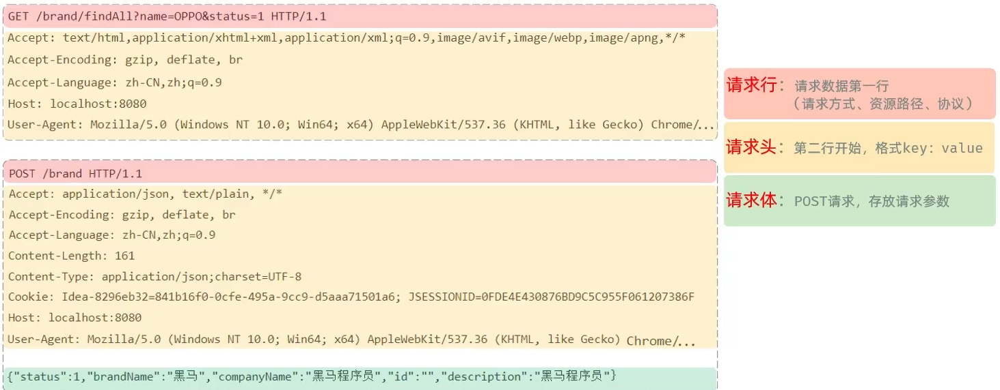
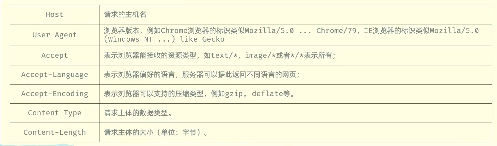
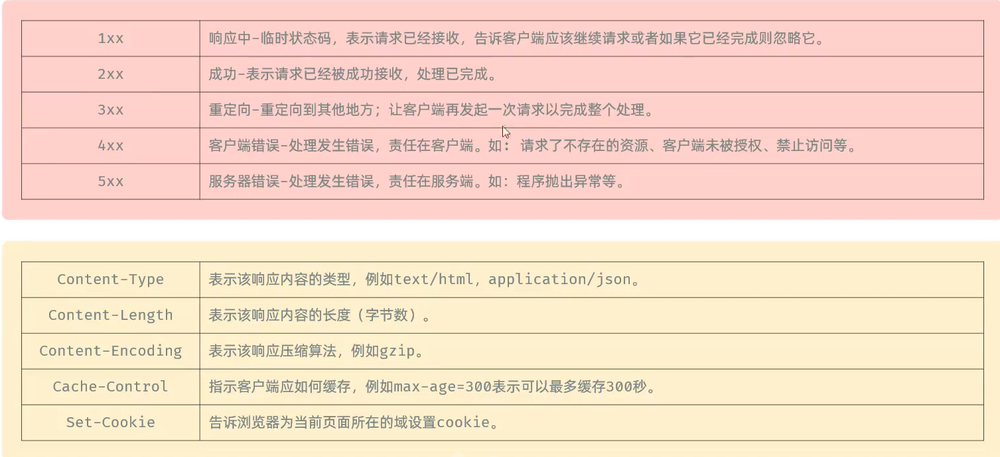

Java 官方规范要求：包名**全部为小写英文字母，单词直接拼接，不使用下划线、驼峰、中划线**
包是组织.项目名，不要理报错
---
## 在vscode中新建SpringBoot项目
- 右键
  创建java项目
- 选择springboot
- 选择maven
- 选择父模板
- 写好组织名，项目名
- 添加依赖

---
## 在vscode中启动SpringBoot项目
点击：Maven中Plugins中spring中run

---
## 常用依赖
spring-boot-starter-web：包含了web应用开发所需要的常见依赖。
spring-boot-starter-test：包含了单元测试所需要的常见依赖。

---
## 注解
- `@SpringBootApplication`：
  贴在启动类上，Spring 扫描到该注解后，会自动开启组件扫描、自动配置、包扫描等一整套项目初始化能力，是 Spring Boot 的核心入口标记。
- `@RestController`：
  贴在类上，Spring 识别后会将该类注册为 Web 控制器，自动负责接收 HTTP 请求、把方法返回值转为响应数据。
- `@RequestMapping("/hello")`：
  贴在方法上，告诉 Spring「路径为 `/hello` 的请求，由这个方法来处理」，建立 URL 和业务方法的映射关系。
  **路径不能重复**
- `@GetMapping` :
  是 `@RequestMapping` 的**派生简化注解**，专门用来限定「只接收 GET 方式的请求」；而 `@RequestMapping` 不指定请求方式时，默认支持 GET、POST、PUT、DELETE 等所有 HTTP 请求方法。
  >简单说：`@GetMapping("/hello")` = `@RequestMapping(value = "/hello", method = RequestMethod.GET)`
---
## HTML协议
### 1.请求数据格式

- 请求行
  第一行，包括请求方法，请求资源路径（GET方式带参数），HTTP版本
- 请求头
  json格式
  
- 请求体
  POST方式存放请求参数，大小无限制
- 获取请求数据
  使用方法
  ```java
  @RequestMapping(/request)
  public String request(HttpServletRequest request){

    ...
  }
  ```
  调用HttpServletRequest类的方法就好了
  ```@RequestMapping(/request)```表示访问路径/request的都会交给该方法处理
### 2.响应数据格式

- 响应行
  - 常见状态码
      
- 响应头

- 响应体

- 获取响应数据
  - 法一 
    使用方法
    ```java
    @RequestMapping(/response)
    public void response(HttpServletResponse response){

      ...
    }
    ```
    调用HttpServletResponse类的方法就好了
  - 法二
    使用方法
    ```java
    @RequestMapping(/response)
    public ResponseEntity<String> response(){
      return ResponseEntity.status().header().body();
    }
    ```    
    返回一个ResponseEntity<String>类型
    用流的形式来设定响应状态码，响应头，响应体
  >通常不设置响应状态码和响应头,因为服务器会自动设置