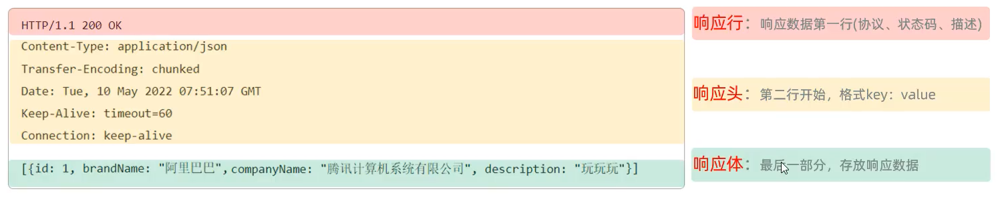
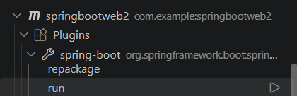

Java 官方规范要求：包名**全部为小写英文字母，单词直接拼接，不使用下划线、驼峰、中划线**
包是组织.项目名，不要理报错
---
## 在vscode中新建SpringBoot项目
- 右键
  创建java项目
- 选择springboot
- 选择maven
- 选择父模板
- 写好组织名，项目名
- 添加依赖

---
## 在vscode中启动SpringBoot项目
点击：Maven中Plugins中spring中run

---
## 常用依赖
spring-boot-starter-web：包含了web应用开发所需要的常见依赖。
spring-boot-starter-test：包含了单元测试所需要的常见依赖。

---
## 注解
- `@SpringBootApplication`：
  贴在启动类上，Spring 扫描到该注解后，会自动开启组件扫描、自动配置、包扫描等一整套项目初始化能力，是 Spring Boot 的核心入口标记。
- `@RestController`：
  贴在类上，Spring 识别后会将该类注册为 Web 控制器，自动负责接收 HTTP 请求、把方法返回值转为响应数据。
- `@RequestMapping("/hello")`：
  贴在方法上，告诉 Spring「路径为 `/hello` 的请求，由这个方法来处理」，建立 URL 和业务方法的映射关系。
  **路径不能重复**
- `@GetMapping` :
  是 `@RequestMapping` 的**派生简化注解**，专门用来限定「只接收 GET 方式的请求」；而 `@RequestMapping` 不指定请求方式时，默认支持 GET、POST、PUT、DELETE 等所有 HTTP 请求方法。
  >简单说：`@GetMapping("/hello")` = `@RequestMapping(value = "/hello", method = RequestMethod.GET)`
---
## HTML协议
### 1.请求数据格式

- 请求行
  第一行，包括请求方法，请求资源路径（GET方式带参数），HTTP版本
- 请求头
  json格式
  
- 请求体
  POST方式存放请求参数，大小无限制
- 获取请求数据
  使用方法
  ```java
  @RequestMapping(/request)
  public String request(HttpServletRequest request){

    ...
  }
  ```
  调用HttpServletRequest类的方法就好了
  ```@RequestMapping(/request)```表示访问路径/request的都会交给该方法处理
### 2.响应数据格式

- 响应行
  - 常见状态码
      
- 响应头

- 响应体

- 获取响应数据
  - 法一 
    使用方法
    ```java
    @RequestMapping(/response)
    public void response(HttpServletResponse response){

      ...
    }
    ```
    调用HttpServletResponse类的方法就好了
  - 法二
    使用方法
    ```java
    @RequestMapping(/response)
    public ResponseEntity<String> response(){
      return ResponseEntity.status().header().body();
    }
    ```    
    返回一个ResponseEntity<String>类型
    用流的形式来设定响应状态码，响应头，响应体
  >通常不设置响应状态码和响应头,因为服务器会自动设置
## 案例
### 1.准备好数据和前端
- 在main\resources下保留user.txt存放用户数据
- 在main\resources\static下存放前端页面user.html
  **后续访问该user.html**
### 2.启动位置
直接在com\example下保留启动的main方法,这样能识别到com\example下的所有包
### 3.用户数据格式
- 用类保存
- 类在com\example\pojo\User.java中实现
- 这里用到了lombok插件
  ```java
  // 存储列表的每一行
  @Data//这个标注自动为类所有属性创造get/set方法。由lombok提供
  @NoArgsConstructor//无参数构造，即构造时无参数传入
  @AllArgsConstructor//全参数构造，即构造时传入每一个属性的参数
  public class User {
    private Integer id;
    private String username;
    private String password;
    private String name;
    private Integer age;
    private LocalDateTime upDateTime;
  }
  ```
  可以免于写构造函数
### 4.访问控制
- 在com\example\restcontroller中实现
- 这里用到了插件hutool
  ```java
  InputStream in = this.getClass().getClassLoader().getResourceAsStream("user.txt");
  ArrayList<String> lines = IoUtil.readLines(in, StandardCharsets.UTF_8,new ArrayList<>());
  ```
  先建立输入流in,绑定到user.txt文件上,因为最后是打包成jar来运行的,所以用这种相对路径的方法
  - `src/main/java`：存放 Java 代码，编译后进入 classpath
  - `src/main/resources`：存放配置文件、静态资源，编译后**同样进入 classpath**
  
  解析:
  1. `this.getClass()`：获取当前对象的 Class 类对象。
  2. `.getClassLoader()`：获取加载该类的类加载器，它负责读取所有 classpath 下的类和资源。
  3. `.getResourceAsStream("user.txt")`：在 classpath 根目录下查找名为 `user.txt` 的文件，以输入流的形式返回。
     - 参数 `user.txt` 是**相对 classpath 根目录的路径**，对应源码中 `src/main/resources/user.txt` 的位置。
     - 如果文件在子目录里，比如 `resources/data/user.txt`，参数就写 `"data/user.txt"`。
  `IoUtil.readLines()`方法,从in中读取所有行,编码格式UTF_8,返回是new ArrayList<>()
- 然后从读取到的行列表中,用流的方式,做成一个存User的列表
  直接返回就好了,正常是要返回JSON格式字符串,但是也能用
### 5.启动

## 三层架构
### 1.三层
- dao
  数据访问
- service
  逻辑处理
- controller
  接受请求、响应数据
>controller调用service,service调用dao
### 2.规范
- 在组织下分别建立三个层的文件夹
- 对于dao和service
  通过面向接口的方式来应对不同的情况
  在文件夹下定义一个接口
  在文件夹下新建目录impl，存放具体实现
- 如何使用上一层的方法
  在类里定义好接口和实现,然后在方法里调用上一层的方法
## 3.示例
见springbootweb2项目