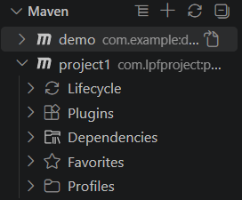
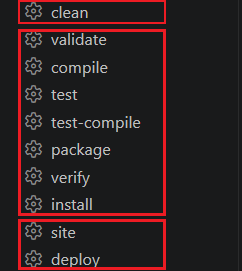
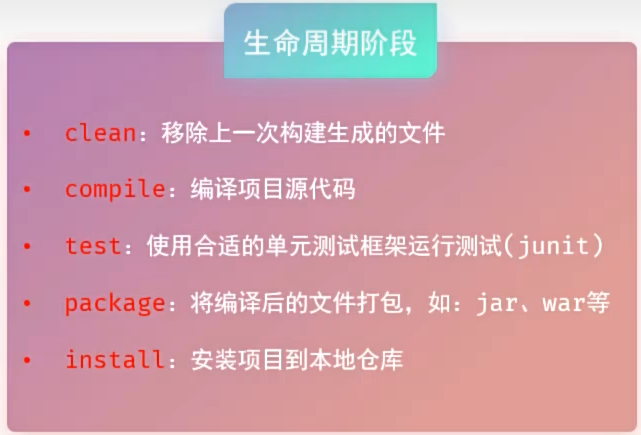
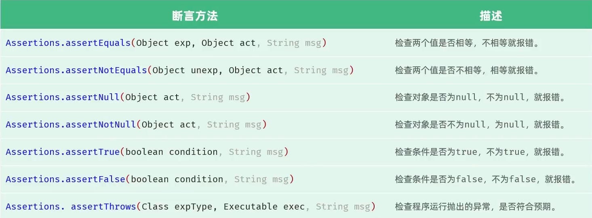
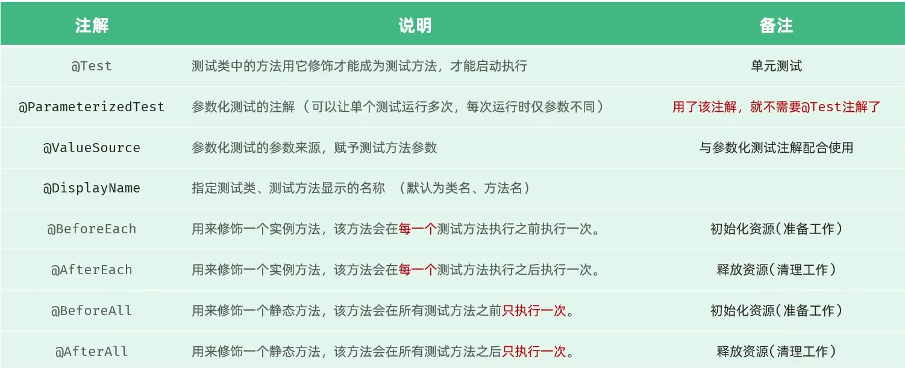

## 如何在vscode中使用
### 1.右键

### 2.选择继承
### 3.输入组织与项目名

---
## 依赖配置
### 1.坐标
形如
```xml
<groupId>com.lpfproject</groupId>
<artifactId>project1</artifactId>
<version>1.0-SNAPSHOT</version>
```
在仓库的./com/lpfproject/project1/1.0-SNAPSHOT
### 2.导入依赖
导入的是jar
```xml
<dependencies>
  <!-- 导入依赖 -->
  <dependency>
    <groupId>org.springframework</groupId>
    <artifactId>spring-context</artifactId>
    <version>6.14</version>
    <!-- 导入这个依赖,会传递导入它的依赖,可以排除不要的 -->
    <exclusions>
      <exclusion>
        <groupId>io.micrometer</groupId>
        <artifactId>micrometer-observation</artifactId>
        <!-- 不需要指定版本,因为本身是跟着依赖传递过来的,只会有一个版本 -->
      </exclusion>
    </exclusions>
  </dependency>

</dependencies>
```
### 3.依赖的读取顺序
本地仓库->远程仓库->maven的中心仓库
如果本地仓库没有,会从远程仓库读取并在本地仓库也保留一份
如果远程仓库没有,会在maven的中心仓库读取并在远程仓库和本地仓库都保留一份

---
## maven的生命周期
### 1.位置

### 2.三类生命周期

红框圈起来的属于一类
在每类中执行一个命令，同一类的之前的指令也会执行
主要关注

### 3.clean
清理上一次编译的结果，即删除target文件夹
### 4.install
可以在本地仓库找到这次的项目，通过pom.xml的
```xml
<groupId>com.lpfproject</groupId>
<artifactId>project1</artifactId>
<version>1.0-SNAPSHOT</version>
```
定位
比如这个就是在本地仓库的./com/lpfproject/project1/1.0-SNAPSHOT

---
## 单元测试
>示例见demo
### 1.导入junit
导入5.的版本,和4.的不太一样
```xml
<!-- JUnit 5 核心API -->
<dependency>
  <groupId>org.junit.jupiter</groupId>
  <artifactId>junit-jupiter-api</artifactId>
  <version>5.9.2</version>
  <scope>test</scope>
</dependency>
<!-- JUnit 5 测试执行引擎 -->
<dependency>
    <groupId>org.junit.jupiter</groupId>
    <artifactId>junit-jupiter-engine</artifactId>
    <version>5.9.2</version>
    <scope>test</scope>
</dependency>
```
`junit-jupiter-engine` 是 **JUnit 5 的测试执行引擎**，它是真正负责「运行写的测试用例」的核心组件
### 2.基本语法
在src\test\java\组织\项目名中新建xxxTest.java(也可以叫其他的)
然后在文件类里面新建测试方法
```java
@Test
public 类型 方法名(...){

  ...
}
```
其中,@Test和public是必须的
要导入```import org.junit.jupiter.api.Test;```
### 3.开始测试
启动test生命周期就好了
### 4.断言
不只是想测试会不会报错，还想测试方法是否产生预期的结果
要导入```import org.junit.jupiter.api.Assertions;```
方法如下

msg是可选提示信息
### 5.常见注解

### 6.参数化测试
需导入依赖
```xml
<dependency>
    <groupId>org.junit.jupiter</groupId>
    <artifactId>junit-jupiter-params</artifactId>
    <version>5.9.2</version>
    <scope>test</scope>
</dependency>
```
需导入包
```java
import org.junit.jupiter.params.ParameterizedTest;
import org.junit.jupiter.params.provider.ValueSource;
```
示例见demo的AppTest
```java
@ParameterizedTest
@ValueSource(strings = {"123456789123456789","123456789123456799","123456789123456788"})
public void getGender(String ids){
    App app = new App();
    String gender = app.getGender(ids);
    System.out.println(gender);
}

@ParameterizedTest
@CsvSource({
    "123456789123456789, 女",
    "110101199001011234, 男",
    "440101199505056789, 女"
})
public void testGetGender(String idCard, String expectedGender) {
    App app = new App();
    String result = app.getGender(idCard);
    assertEquals(expectedGender, result);
}
```
说明:
- ids会自动遍历字符串数组的元素
- `strings`
声明参数类型为 String 字符串，是 ValueSource 内置的类型属性之一。除了字符串，它还支持多种基础类型，每种对应一个属性名：
  - `ints`：对应 `int` 整数
  - `longs`：对应 `long` 长整数
  - `doubles`：对应 `double` 浮点数
  - `chars`：对应 `char` 字符
  - `booleans`：对应 `boolean` 布尔值
  - `classes`：对应 `Class` 类对象
- Csv格式
  每一个字符串代表一行,其用逗号分成不同的列
  