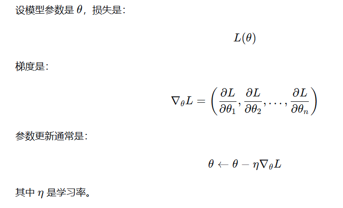

### 一.数据准备
---
### 二.数据处理
  **需要输入输出数据对**
  **输入数据右移一个token就是输出数据对,上下文长度不变**
  1. 上下文长度content_length
    大模型每次允许输入的token数
    样本会分段输入
  2. 移动步幅stride
    大模型上下文窗口移动的步幅
    越小重复输入的token越多,越大则越少,当stride大于context_length时,完全不会重复
  3. batchsize
    每次输入模型的样本数.
### 三.大模型
  1. 可以分为三层
    嵌入层->transformer层->输出层
    1. 嵌入层
      文字转换为向量
    2. transformer层
      核心环节,捕捉上下文语意,理解意思
    3. 输出层
      通常是个简单的全连接层,输出每个单词的预测结果
  2. 嵌入层
    1. 需要一个向量矩阵,行数为token数,列数随意,列数表示这个词元的向量维度,维度越大,向量的信息越大
    2. 输入不能是词元,而应该是向量
    3. 向量除了其本身的维度信息,还应该再加上这个词的位置信息,再输入给大模型,有两种方法获取位置信息
      - 训练法
      - 公式法

      现在相对位置编码更常用
    4. 取向量的方式
      - 可以是用one-hot编码来取,每一个token对应一个一行矩阵,其中只有其对应位置是1,其他都是0,这个矩阵乘上向量矩阵就得到了他的向量,于是向量就变成了一个线性运算
    5. 注意力矩阵
      对一个向量,将其与其他所有向量求点积,把在它后面的词记为负的无穷大,这样就不会注意到后面的词,避免后续训练时已知后续输出.
      得到的结果再归一化,作为系数乘上对应向量,得到和原来大小一样的新向量,就是该向量的注意力矩阵.其他向量同理
      注意力向量表现了当前向量与其他向量的相关度
      这里引入QKV矩阵:
      - 因为每个向量都有三种操作
      - 一是作为查询者,查询其他向量和它的相关度
      - 二是作为被查询者,被用来点乘,计算和查询者的相关度
      - 三是生成新的注意力向量
      于是把向量做成三个,Q,K,V向量,Q负责查询,K复制被查询,V负责最后生成向量
      QKV向量的获取是通过Wq,Wk,Wv矩阵得到的,这三个权重矩阵是可以更新的,会在训练时找到最好的权重矩阵
      注意力矩阵是个方阵
  3. Transformer
    多层,输入和输出的维度得是一样的,会进行多次Transform
    需要做归一化，残差连接
  4. 输出层
    会计算损失，确定下一个词，候选词词出现的概率。
    不是选概率越大的词越好，因为局部最优不一定全局最优
    - tempreture参数
      tempreture越大，输出越多样
    可以限定候选词的数量
    - TopK，
      只在概率最大的k个候选中选
    - TopP
      从大到小，选取概率之和超过P的部分
    - minP
      舍去概率小于P的词

### 梯度是什么
梯度就是损失函数对参数的偏导数，表示：参数往哪个方向稍微改一点，损失会上升/下降多少。
